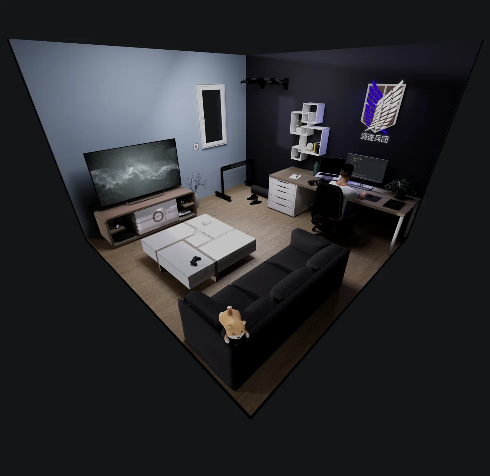
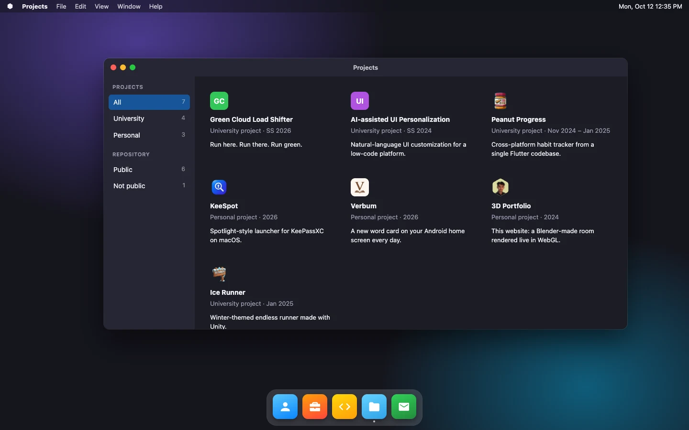

# React Three Fiber Portfolio

A personal portfolio in two parts: a **3D room** built in Blender and rendered live
with **React Three Fiber**, and a **macOS-style desktop** on the laptop screen that
holds the actual content (About, Experience, Skills, Projects, Contact).





## Demo

[Live Portfolio](https://sajid-rehan.github.io/r3f-portfolio/)

| Link                                                   | Opens                                 |
| ------------------------------------------------------ | ------------------------------------- |
| `https://sajid-rehan.github.io/r3f-portfolio/`         | The 3D room (skip link in the corner) |
| `https://sajid-rehan.github.io/r3f-portfolio/#desktop` | The desktop directly, without the 3D  |

## How it works

- **Room:** click a sign (About, Skills, Projects) and the camera flies to the laptop,
  where the desktop opens with the matching app. Contact goes to the visiting card.
  Closing a section leaves you in explore mode (drag to look around).
- **Desktop:** draggable, focusable windows, a dock with minimize / restore, and
  maximize. A "Room" icon behind the divider goes back to the 3D scene.
- **Small screens (< 900 px):** the camera still flies to the laptop, then the screen
  fades into the full-screen desktop. Windows float with a small gap, the dock sits at
  the bottom, and the browser back button returns to the room.
- **Camera:** the field of view and camera distance are fitted to the viewport
  (`src/util/responsiveCamera.js`), live on resize and rotation.

## Installation

1. **Clone the repository**:

   ```bash
   git clone https://github.com/sajid-rehan/r3f-portfolio.git
   cd r3f-portfolio
   ```

2. **Install dependencies** (`yarn install` works as well):

   ```bash
   npm install
   ```

3. **Start the development server**:

   ```bash
   npm run dev
   ```

   Then open `http://localhost:5173/r3f-portfolio/`. Add `--host` to try it on a phone
   on the same network (`npm run dev -- --host`).

Other scripts: `npm run build`, `npm run preview`, `npm run deploy` (GitHub Pages).

## Editing the content

| What                       | Where                            |
| -------------------------- | -------------------------------- |
| Name, bio, links, focus    | `src/data/data.js`               |
| Projects (media, links)    | `src/data/projects.js`           |
| Work experience, education | `src/data/experience.js`         |
| Skills                     | `src/desktop/apps/SkillsApp.jsx` |

Project icons and media live in `public/assets/projects/` (icons) and
`public/assets/projects/media/` (screenshots, video). Keep them small: WebP for
images, H.264 `yuv420p` for video (other pixel formats break in Firefox).

## Developing the desktop on its own

The desktop does not depend on the 3D code, so it can be developed in isolation:
`http://localhost:5173/r3f-portfolio/desktop.html` shows it full screen. This page is
for development only and is not part of the production build.

## File structure

```bash
.
├── public
│   ├── assets            # Avatar and project icons / media
│   ├── models            # 3D models (Blender exports)
│   └── textures          # Baked texture, avatar texture, screen videos
├── src
│   ├── components        # 3D scene (Scene, Experience, Avatar, screens, buttons)
│   ├── contexts          # Navigation (section, room/desktop mode) and orbit controls
│   ├── data              # Content: bio, projects, experience
│   ├── desktop           # The macOS-style desktop (windows, dock, apps)
│   ├── util              # Camera animation, responsive camera, viewport helpers
│   ├── App.jsx           # Canvas, navigation buttons, room / desktop switch
│   └── main.jsx          # Entry point
├── desktop.html          # Dev-only entry for the desktop
└── vite.config.js
```

## Known issues

- **iPhone Safari:** the video faces in the room can be black at first, and the native
  video player may pop up.
- **Firefox on Android:** after going from the desktop back to the room, the screens
  show a plain colour.
- **Safari on Mac:** the laptop screen can be laggy. The CSS3D `<Html occlude>` check
  raycasts the whole room every frame and is the likely cause.
- In all these cases the `#desktop` link still works, because it does not use the 3D
  scene or video.

## License

This project is licensed under the MIT License. You are free to use, modify, and
distribute it as long as you retain the original copyright.
